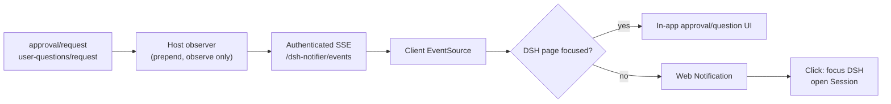

<p align="center">
  
</p>

<h1 align="center">DSH Browser Notifications</h1>

<p align="center">
  A small DSH plugin that turns pending approvals and questions into browser system notifications.
</p>

<p align="center">
  <a href="LICENSE"></a>
  
</p>

When DSH is waiting for you—an approval for a tool call or an `ask_user_question` prompt—it is easy to miss while another tab or window has your attention. This plugin uses the browser's Web Notifications API to surface that request without `notify-send`, AppleScript, PowerShell, or any native helper binary.

## Features

- Notifies on permission approvals (`approval/request`).
- Notifies on structured questions (`user-questions/request`), including plan reviews.
- Works while the DSH tab is in the background, another browser tab is active, or the browser is minimized.
- Clicking the notification focuses DSH and opens the Session that needs attention.
- Includes the tool/question summary and, for approvals, the reason.
- Localized UI and notification copy in English and Simplified Chinese.
- No native notification daemon and no runtime dependencies.
- The observer never answers, denies, or delays a request: it only calls `next()`.

## How it works



The Host listener uses `prepend: true`. The shipped browser answerer owns the request waterfall and waits for the user, so observing before it runs is what makes the notification timely. The listener always delegates with `next()` and does not change the outcome.

The Client half connects to one same-origin SSE endpoint. The endpoint sits behind DSH's existing connection fence (`ctx.connection.requestRejection`), so it uses the browser session cookie and adds no new authentication mechanism.

## Requirements

- A DSH Web profile (`dsh web`).
- A browser with the Web Notifications API:
  - Chrome/Edge, Firefox, or Safari on desktop.
  - A secure context: HTTPS or `localhost` / `127.0.0.1`.
- The DSH page must stay open. The plugin cannot notify after the tab or browser is fully closed.

## Install

This directory is a DSH bundle. Install it through DSH's Plugin Manager:

1. Clone the repository:
   ```bash
   git clone https://github.com/AlleyRain/dsh-notifier.git
   ```
2. Install the cloned directory as a local bundle in the active profile:
   - **Agent route (recommended):** ask DSH to call `plugin_manager` with `action: install_bundle` and the absolute path to the cloned directory.
   - **UI route:** if your DSH build exposes a local-bundle installation control in Plugins, select the cloned directory there.
3. The bundle is selected for the profile and survives DSH restarts.

The install writes the bundle selection and package dependency into the active profile. Do not hand-edit the profile's `package.json`.

> The package name is `@local/dsh-notifier` because this is a local bundle. It is not published to npm.

## Enable notifications

1. Open **Settings → General**.
2. Find **Browser notifications** (between Language and Appearance).
3. Click **Enable notifications** and allow the browser permission prompt.
4. Click **Send test** to confirm the system notification appears.

The permission request is deliberately tied to that button. DSH does not prompt for notification permission on page load.

## Behavior

| DSH page state | Result |
| --- | --- |
| Foreground and focused | In-app approval/question UI only; no system notification |
| Background tab, other tab active, minimized | Browser system notification |
| Tab closed | No notification; the SSE connection is gone |
| Browser fully closed | No notification |
| OS Do Not Disturb / Focus | The system may suppress the notification |

Additional details:

- Notifications opened by this plugin are dismissed when the DSH page regains focus.
- Multiple DSH tabs receive the same event. A stable notification `tag` lets browsers that support it replace the duplicate instead of stacking it.
- Approval policy `never` never asks, so it never notifies.
- The plugin does not change approval policy or answer questions on your behalf.

## Notification content

- **Approval:** tool name, approval reason, or the localized display reason.
- **Question:** the header plus the first question, followed by the number of additional questions in the batch.
- Clicking a notification focuses DSH and opens the Session that owns the request.

## Troubleshooting

### The Enable button is still shown, or the test notification does not appear

- Check the site's notification permission in the browser's site settings.
- On macOS, check **System Settings → Notifications** for the browser.
- On Windows, check **Settings → System → Notifications** and Focus assist.
- Ensure the page is served from `localhost`, `127.0.0.1`, or HTTPS. Plain `http://` on a non-loopback host is not a secure context.
- After changing a blocked permission, reload the DSH page.

### Notifications appear for a background tab but not while DSH is focused

That is intentional: the in-app UI is already visible and a system notification would duplicate it. This version has no switch for that behavior.

### No notification after closing the tab or browser

Browser notifications require a live page and SSE connection. Delivery with the browser fully closed would need a separate OS-level backend.

### Mobile browsers

Mobile Chrome generally requires a Service Worker registration to display notifications. This version targets desktop browsers.

## Security and privacy

- The plugin adds no external network calls. Notifications travel only from the local DSH Host to the same-origin browser page over the authenticated SSE endpoint.
- The SSE endpoint uses DSH's existing `connection.requestRejection` fence.
- Payloads contain only the tool name, approval reason, and question text already shown in DSH. The plugin does not persist them.
- The Host observer never returns a decision; it only delegates with `next()`.

## Development

No build step and no runtime dependencies.

```bash
node --check index.js
node --check client.js
node --test test/*.test.js
```

Layout:

| Path | Purpose |
| --- | --- |
| `index.js` | Host bundle: SSE endpoint and the two prepended request observers |
| `client.js` | Browser bundle: SSE subscription, Web Notifications, General settings row |
| `locale/en.json`, `locale/zh.json` | Plugin Manager title and description |
| `test/` | Host payload, framing, route, and lifecycle tests |
| `cordis.patch.yml` | Bundle row inserted into the DSH profile |

## Verified against

- DSH `0.2.1-rc.3`, Web profile.
- Desktop browsers with the Web Notifications API.

<details>
<summary>中文说明</summary>

- **作用**：当 DSH 等待你审批工具调用或回答 `ask_user_question` 时，通过浏览器系统通知提醒你。
- **行为**：DSH 页面在前台且聚焦时不弹系统通知；切到其他标签页、其他窗口或最小化浏览器时弹出。点击通知会回到 DSH 并打开对应 Session。
- **安装**：把本目录作为本地 bundle 安装到当前 Web profile。
- **启用**：设置 → 通用 → 浏览器通知 → 启用通知；授权后点「发送测试」。
- **限制**：DSH 页面必须保持打开；浏览器完全退出或系统勿扰模式开启时收不到通知。
- **权限**：通知只在本机 DSH Host 与同源页面之间通过已鉴权的 SSE 传输，不访问第三方服务。

</details>

## License

MIT © 2026 AlleyRain. See [LICENSE](LICENSE).
